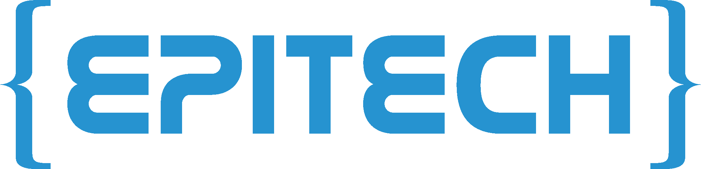

<picture>
  <source media="(prefers-color-scheme: dark)" srcset="assets/banner-dark.svg">
  
</picture>

<picture>
  <source media="(prefers-color-scheme: dark)" srcset="assets/upec-dark.svg">
  
</picture>
&nbsp;&nbsp;&nbsp;&nbsp;

&nbsp;&nbsp;&nbsp;&nbsp;
<picture>
  <source media="(prefers-color-scheme: dark)" srcset="assets/nickel-dark.svg">
  
</picture>

### Apprenti DPO - *Nickel*, fintech du groupe BNP Paribas

<b>CERTIFICATIONS OBTENUES</b>
 

  
<b>EN PRÉPARATION</b>
 

## <picture><source media="(prefers-color-scheme: dark)" srcset="assets/title-parcours-dark.svg"></picture>

- **MBA Data : Protection & Sécurité des données** - *Epitech*
- **Licence de droit général** - *Université Paris-Est Créteil (UPEC)*

## <picture><source media="(prefers-color-scheme: dark)" srcset="assets/title-stack-dark.svg"></picture>

**Bibliothèques et outils :** `pandas` · `matplotlib` · `streamlit` · `hashlib` · `sqlite3` · …

---

## <a href="https://github.com/Leo-TRS/GDPR_auditor_V2"><picture><source media="(prefers-color-scheme: dark)" srcset="assets/title-lead-project-dark.svg"></picture></a>

**Assistant d'audit de conformité propulsé par l'IA**, fondé sur un système de **RAG** (*Retrieval-Augmented Generation*) : les réponses s'appuient sur un corpus de textes officiels et **citent leurs sources**.

**Corpus juridique :** RGPD · AI Act · Loi Informatique et Libertés (LIL)

- 🔍 **Audit de document** - politique de confidentialité, contrat ou registre de traitement : l'outil identifie les manquements et cite les articles concernés
- 💬 **Chatbot RGPD** - questions en langage naturel, réponses sourcées
- 📰 **Veille** - décisions de la CNIL et du CEPD, actualité de l'AI Act, résumées par l'IA

---

## <picture><source media="(prefers-color-scheme: dark)" srcset="assets/title-domaines-dark.svg"></picture>

- **Protection des données** - RGPD, Loi Informatique et Libertés, registre des traitements, analyse de contrats et de clauses
- **Régulation de l'IA** - AI Act
- **Sécurité** - hachage, chiffrement, bonnes pratiques de stockage des secrets
- **IA juridique** - RAG, extraction et vérification automatisées de documents, veille juridique
